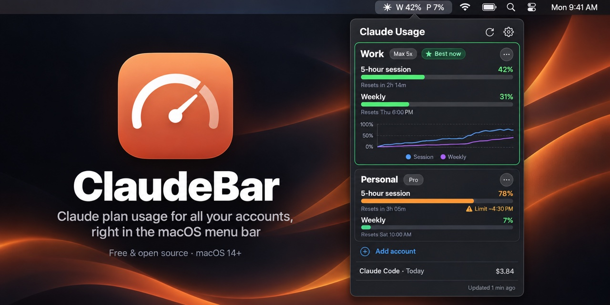

# ClaudeBar



[](https://github.com/eslamkhames/claude-usage/actions/workflows/build.yml)
[](LICENSE)

> **Unofficial.** ClaudeBar is an independent open-source project. It is not affiliated with, endorsed by or supported by Anthropic. "Claude" is a trademark of Anthropic, PBC.

A small macOS menu bar app that shows Claude plan usage (5-hour session, weekly, and per-model weekly limits) for **several claude.ai accounts at once**.

```
✳ W 42%  P 7%
```

## How it works

- Each account you add gets its own isolated WebKit cookie jar, so multiple claude.ai logins coexist.
- Usage is read from claude.ai's own `/api/organizations/{id}/usage` endpoint through an invisible web view, so Cloudflare checks and cookie refreshes behave like Safari.
- The organization carrying the Pro/Max subscription is picked automatically.
- Nothing leaves your Mac except the requests to claude.ai and a daily update check against GitHub releases.

## Privacy & security

- Session cookies are kept in per-account WebKit data stores on your Mac and are only sent to claude.ai. There is no server, analytics or telemetry.
- The **Paste session key** option is for your own accounts only. A `sessionKey` grants full access to a claude.ai account, so never share it or paste it into an issue.
- Found a vulnerability? See [SECURITY.md](SECURITY.md).

## Install

Download `ClaudeBar.zip` from the [latest release](https://github.com/eslamkhames/claude-usage/releases/latest), unzip it and move `ClaudeBar.app` to `/Applications`.

The app isn't notarized by Apple, so macOS blocks it the first time. Right-click it in Finder → **Open**, then confirm. (On recent macOS versions you may need to allow it under System Settings → Privacy & Security instead.)

## Build from source

Requires macOS 14+ and the Xcode command line tools (`xcode-select --install`).

```sh
./build.sh            # builds build/ClaudeBar.app
./build.sh --install  # also copies it to /Applications and launches it
```

The app is ad-hoc signed. If macOS blocks it on first launch, right-click it in Finder → **Open**.

## Usage

1. Click the menu bar item → **Add account**, give it a name (e.g. "Work"), and sign in in the window that opens. It closes by itself once you're signed in.
2. If Google sign-in refuses the embedded browser, use **Continue with email**, or click **Paste session key instead** and paste the `sessionKey` cookie from your normal browser (DevTools → Application → Cookies → `claude.ai`).
3. Repeat for each account. The `⋯` menu on an account can refresh it, open claude.ai signed in as it, sign in again, rename it, set its menu bar label (up to 3 letters), hide it from the menu bar, turn its notifications off, reorder it, or remove it.

## Features

- **Menu bar styles:** text (`✳ W 42%  P 7%`), bars (session over weekly), rings, or a single icon for the highest usage. Optionally shows the time left until reset.
- **Notifications** when an account passes the warning or critical threshold, when a limit you were close to resets, and when an account gets signed out.
- **Best account:** the account with the most room left is outlined in green.
- **Usage chart** for the last 24 hours or 7 days, and an estimate of when you'll hit the limit at the current pace.
- **Out-of-date numbers fade** and show their age. Numbers drop to 0% as soon as the reset time passes.
- **Plan badge** (Pro, Max 5x, …) and per-model weekly limits with their reset times.
- **Claude Code usage** from `~/.claude/projects` for today or the last 7 days: tokens and the API-price equivalent per project.
- **Global shortcut** to open the panel, chosen from a few presets.
- **Refreshes** after waking from sleep and when the network comes back.
- **Updates from GitHub releases**, checked once a day and installed from the panel.

Every option can be switched on or off in **Settings** (gear icon).

## Releasing

Push a tag such as `v1.2`. The Release workflow builds the app, zips it and publishes a GitHub release, which the app then offers as an update. The repository must be public for the update check to see it.

Usage history is kept for 8 days in `~/Library/Application Support/ClaudeBar/history.json`. The icon comes from `swift tools/make-icon.swift Resources/AppIcon.icns`.

## Limitations

ClaudeBar reads claude.ai's **undocumented internal** usage endpoint, the same one the claude.ai website uses. It isn't a public API, so it can change or break without notice. If numbers stop showing, the parser in `Sources/Models.swift` is the place to update. Use the app in line with Anthropic's terms for your account.

## Contributing

Issues and pull requests are welcome. See [CONTRIBUTING.md](CONTRIBUTING.md) for how to build and where things live.

## License

[MIT](LICENSE)
